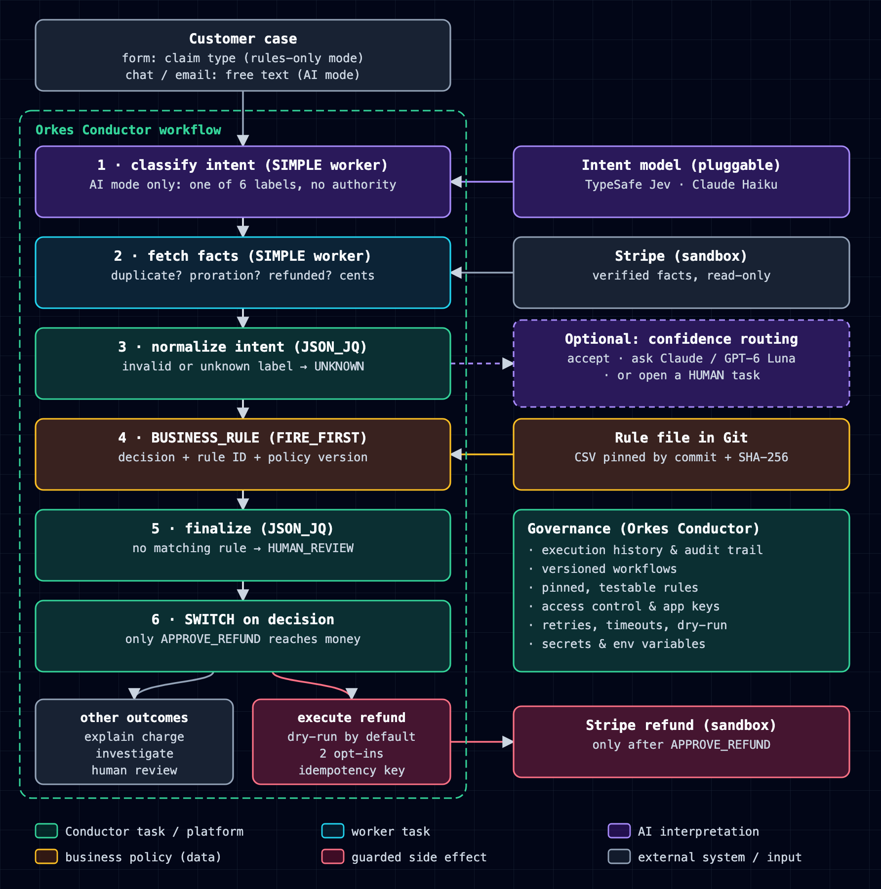

# Orkes + Stripe Decisions

**Stop replacing business logic with prompts. Add AI to your rules instead.**

This reference app handles billing support for a fictional SaaS company on [Orkes Conductor](https://orkes.io):

- **Stripe sandbox** data is the only financial evidence.
- A native, version-pinned Conductor **`BUSINESS_RULE`** task is the only policy authority.
- **AI** (TypeSafe Jev or Claude Haiku 5.5) only interprets what the customer's message means.

> AI expands what the workflow can *understand*. Deterministic policy still governs what it can *do*.

This is educational software. The refund policy is a fictional demo policy, not Stripe guidance or legal advice.
Stripe access is sandbox-only, and refunds are dry-run unless you opt in twice.

## Architecture



```
customer case ──► [sd_classify_intent]* ──► [sd_fetch_billing_facts] ──► normalize_intent (JQ)
                   AI: interpretation only     Stripe sandbox: evidence      invalid/unknown -> UNKNOWN
                                                                                   │
                       ┌───────────────────────────────────────────────────────────┘
                       ▼
          billing_support_policy  (BUSINESS_RULE, FIRE_FIRST, pinned CSV)  ──► finalize (JQ: no match -> HUMAN_REVIEW)
                                                                                   │
                                                  SWITCH: only APPROVE_REFUND ──► [sd_execute_refund] (guarded, idempotent)
* billing_rules_ai only. billing_rules_only reads the intent from a structured form field instead.
```

| Mode | Workflow | Intent source | Policy |
|---|---|---|---|
| Rules only | `billing_rules_only` v1 | structured form field | `billing_support_policy` BUSINESS_RULE, pinned CSV |
| Rules + Jev | `billing_rules_ai` v1, `classifier=jev` | TypeSafe Jev `jev-1.14.0` (Choice question) | **same** rule file and version |
| Rules + Claude | `billing_rules_ai` v1, `classifier=claude` | Claude `claude-haiku-5-5` (structured output) | **same** rule file and version |

- The rule file is `rules/billing_support_policy.v1.csv`, pinned by commit URL and SHA-256 in `rules/policy_release.json`.
- `billing_policy_eval` v1 is a side-effect-free workflow containing only the rule. The benchmark uses it.
- A test asserts that all three workflows use the identical `ruleFileLocation`.
- Details: [docs/architecture.md](docs/architecture.md).

## Benchmark results (run `20261121T022545Z`)

The benchmark has 120 synthetic cases. The author's labels were confirmed by a blind independent review (117/120 agreed, Cohen's κ = 0.970; the 3 disagreements were adjudicated with no label changes, see [benchmark/label-review/](benchmark/label-review/)). Each model classified every case 3 times
independently (360 calls per model), and every decision came from the same pinned Orkes Business Rule over frozen
facts captured from real Stripe sandbox reads. All 720 model calls, 33 policy evaluations and 72 workflow runs
completed, with 0 provider errors and 0 schema-invalid outputs.

| | Rules only | Rules + Jev 1.14 | Rules + Claude Haiku 5.5 |
|---|---|---|---|
| Intent accuracy, all calls [95% CI] | n/a (form field) | 94.4% [91.6, 96.4] | 98.3% [96.4, 99.2] |
| Same intent on all 3 repeats | n/a | 98.3% of cases | 100% of cases |
| Decision agrees with gold-label decision | 100% (24/24 workflow sample, by construction) | 95.6% | 99.2% |
| Intent errors whose decision was unchanged | n/a | 4 of 20 | 3 of 6 |
| Policy violations (decision more permissive than gold) | 0 | 0 of 360 | 0 of 360 |
| Adversarial cases (11): intent / decision agreement | n/a | 87.9% / 90.9% | 100% / 100% |
| Model-only latency p50 / p95 / p99 (n = 360) | none | 68 / 103 / 137 ms | 1154 / 1351 / 1657 ms |
| Full Orkes workflow p50 / p95 (n = 24) | 282 / 737 ms | 650 / 743 ms | 1859 / 2330 ms |
| Est. model cost per evaluated call | $0 | $0.000023 | $0.000080 |

- On per-case majority labels, 5 cases were labeled correctly only by Claude and 1 only by Jev. An exact McNemar
  test gives p = 0.22, so this dataset doesn't show a statistically significant accuracy difference.
- Only 35 of the 120 gold decisions are automatable at all (29.2%). Claude reached that ceiling, and Jev reached 28.1%.
- Costs are estimates from list prices in [benchmark/pricing.json](benchmark/pricing.json); latency and accuracy are observed.

Full report, with confidence intervals, a per-category table, every model disagreement with its message, Jev's
within-provider confidence table, confusion matrices and limitations:
[results/benchmark/report-20261121T022545Z.md](results/benchmark/report-20261121T022545Z.md).

- Charts: [rates](results/benchmark/report-20261121T022545Z-rates.png) ·
  [by category](results/benchmark/report-20261121T022545Z-categories.png) ·
  [model-only vs workflow latency](results/benchmark/report-20261121T022545Z-latency.png)
- Raw rows (model outputs and raw provider responses, Orkes workflow IDs, timings, errors, cost estimates):
  [results/benchmark/raw/20261121T022545Z/](results/benchmark/raw/20261121T022545Z/)
- An earlier full run with the same configuration, which had two client network timeouts, is kept in
  [results/benchmark/earlier/](results/benchmark/earlier/).
- Methodology: [docs/benchmark-methodology.md](docs/benchmark-methodology.md).

## Verified sandbox refund

One real refund was executed through the workflow on a dedicated scenario (S9, a $12 verified duplicate). It was
read back through the Stripe API, and a replay created no second refund. Details:
[docs/refund-verification.md](docs/refund-verification.md).

## Requirements

- Python 3.12+ and [uv](https://docs.astral.sh/uv/).
- A Stripe **sandbox** secret or restricted key (`sk_test_`/`rk_test_`).
- An Orkes Conductor application key. The free [Developer Edition](https://developer.orkescloud.com) works; the app
  needs workflow and task metadata permissions plus worker access.
- For the AI modes and the benchmark: a TypeSafe API key (Jev) and an Anthropic API key.

| Variable | Purpose |
|---|---|
| `STRIPE_SECRET_KEY` | sandbox key; live keys are rejected |
| `STRIPE_EXPECTED_ACCOUNT` | optional; refuses any other Stripe account |
| `CONDUCTOR_SERVER_URL`, `CONDUCTOR_AUTH_KEY`, `CONDUCTOR_AUTH_SECRET` | Orkes server and application key |
| `TYPESAFE_API_KEY`, `ANTHROPIC_API_KEY` | model providers |
| `TYPESAFE_MODEL` (default `jev-1.14.0`), `ANTHROPIC_MODEL` (`claude-haiku-5-5`), `ANTHROPIC_EFFORT` (`low`) | adapter settings |
| `OSD_ALLOW_SANDBOX_REFUNDS=1` | worker-side opt-in for real sandbox refunds (off by default) |

## Setup and demo

```bash
uv sync
cp .env.example .env         # fill in your own values; .env is gitignored

uv run --env-file .env python -m stripe_decisions stripe-whoami        # must show livemode: false
uv run --env-file .env python -m stripe_decisions seed                 # idempotent; safe to re-run
uv run --env-file .env python -m stripe_decisions verify-seed          # 9/9 scenarios from API reads
uv run --env-file .env python -m stripe_decisions conductor register   # task defs + 3 workflows
uv run --env-file .env python -m stripe_decisions workers              # keep running; ONE instance

uv run --env-file .env python -m stripe_decisions demo --mode rules    # 8/8 expected
uv run --env-file .env python -m stripe_decisions demo --mode jev
uv run --env-file .env python -m stripe_decisions demo --mode claude
```

A 5–10 minute walkthrough is in [docs/demo-script.md](docs/demo-script.md).

| | Scenario (real sandbox objects) | Verified facts | Decision (rule) |
|---|---|---|---|
| S1 | Small duplicate payment | 2 succeeded $35 charges, same billing ref | APPROVE_REFUND (R07), dry-run |
| S2 | Large duplicate payment | 2 succeeded $150 charges | HUMAN_REVIEW (R08) |
| S3 | Upgrade with proration | test clock + `always_invoice` proration | EXPLAIN_CHARGE (R09) |
| S4 | Failed renewal | test clock, renewal declined, `past_due` | INVESTIGATE (R13) |
| S5 | Already refunded | full refund on record | NO_ADDITIONAL_REFUND (R06) |
| S6 | "Something seems wrong with my bill." | nothing anomalous | INVESTIGATE (R19) |
| S7 | $15 goodwill request | nothing anomalous | HUMAN_REVIEW (R15) |
| S8 | "Charged twice": one success + one decline | no verified duplicate | INVESTIGATE (R12) |
| S9 | Refund-execution target (not in the demo) | $12 duplicate, refunded once in verification | was R07; now NO_ADDITIONAL_REFUND (R05) |

Without your own Stripe sandbox, `demo --fixtures` uses the normalized facts in `fixtures/facts/`, captured from real
sandbox reads. You still need an Orkes server: decisions always come from the native Business Rule.

## Reproduce the benchmark

```bash
uv run --env-file .env python -m stripe_decisions benchmark --repeats 3 --max-cost-usd 1
uv sync --group charts && uv run python -m stripe_decisions report               # markdown + PNG charts
uv run python -m stripe_decisions report --rebuild <run_id>                        # recompute from raw rows, no API calls
```

The workers must be running for the workflow phase. A full run makes about 770 model calls and was estimated at
about $0.04 at the list prices in `benchmark/pricing.json`.

## Tests

```bash
uv run pytest                                              # offline: 97 tests
uv run --env-file .env pytest -m live -v      # 23 boundary cases through the real Orkes BUSINESS_RULE
```

## Security model

- **Secrets** are read from environment variables at runtime (`uv run --env-file .env`, or any secret manager
  that exports them). `.env` is gitignored, `.env.example` holds only empty placeholders, and code never prints keys.
- **Stripe**: keys must be `sk_test_`/`rk_test_`, `/v1/balance` must report `livemode=false`, and the account can be
  pinned. Any live-mode object in the facts makes the case `ERROR`, which routes to HUMAN_REVIEW.
- **Policy** lives only in the pinned CSV. `conductor register` refuses to register if the CSV's hash doesn't match
  the release, or if its URL isn't pinned to a commit.
- **AI output** is validated against the intent enum. Malformed output, provider errors and unknown labels become
  `UNKNOWN`, which leads to investigation, never to approval. Prompt-injection text can only change the intent label.
- **Refunds** run only on `APPROVE_REFUND` with a rule ID. They need `dryRun=false` on the workflow and
  `OSD_ALLOW_SANDBOX_REFUNDS=1` on the worker, and are never made from fixture facts. The amount comes from verified
  Stripe facts, not from the customer or a model. The charge is re-read (test mode, owning customer, refundable
  balance), and a stable idempotency key is checked against existing refunds and sent to Stripe.
- **Benchmark outputs** contain only synthetic messages, sandbox test-mode IDs and model outputs, with no customer data.

## Docs

[Architecture](docs/architecture.md) · [Stripe setup](docs/stripe-setup.md) · [Demo script](docs/demo-script.md) ·
[Benchmark methodology](docs/benchmark-methodology.md) · [Refund verification](docs/refund-verification.md) ·
[Blog outline](docs/blog-outline.md) · [Screenshots](docs/screenshots/README.md) (Orkes executions and the Stripe sandbox)
