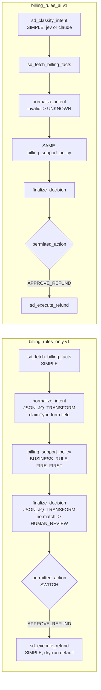

# Architecture

## The one rule

> AI expands what the workflow can **understand**. Deterministic business policy still governs what it can **do**.

Four kinds of data flow through every case, and they are never mixed:

| Data | Source | Trusted for | Never used for |
|---|---|---|---|
| **Customer request** | support form / free text | what the customer *says* | evidence of a billing error |
| **Verified financial facts** | Stripe sandbox API (or frozen, labeled fixtures) | duplicate payments, prorations, refunds, failed payments, refundable cents | interpreting language |
| **AI-derived intent** | TypeSafe Jev or Claude Haiku 5.5 | which of six intents the message expresses | amounts, verification, approval |
| **Policy decision** | Orkes Conductor `BUSINESS_RULE` (pinned CSV) | which action is permitted | anything else |

## Workflows

All three are generated from one template (`src/stripe_decisions/conductor_defs.py`) and committed as importable
JSON in `conductor/workflows/`. A test asserts that every workflow's `BUSINESS_RULE` task uses the identical
`ruleFileLocation`, `executionStrategy: FIRE_FIRST`, input columns and output columns.

`billing_policy_eval v1` is a side-effect-free helper containing only `normalize_intent -> BUSINESS_RULE -> finalize`.
The benchmark uses it to evaluate frozen facts with the same pinned rule, so policy outcomes in the benchmark
come from Orkes, not from Python.

## Responsibility split

| Component | Owns | Must not |
|---|---|---|
| Stripe sandbox | payment, invoice, subscription, refund state | interpret customer text |
| `sd_classify_intent` (Jev / Claude adapters) | mapping free text to one of six intents, with provider metadata | verify payments or authorize refunds |
| `sd_fetch_billing_facts` | reading Stripe, normalizing to YES/NO facts and integer cents | decide outcomes |
| `normalize_intent` (native JQ) | forcing anything outside the enum, or schema-invalid output, to `UNKNOWN` | — |
| `BUSINESS_RULE` | policy: which decision and allowed action | — |
| `finalize_decision` (native JQ) | safe default `HUMAN_REVIEW` when no row matches | — |
| `sd_execute_refund` | safety invariants + idempotent sandbox refund | choose amounts (they come from verified facts) |

## The decision table

`rules/billing_support_policy.v1.csv` (fictional demo policy, not Stripe guidance or legal advice). `FIRE_FIRST`
means row order is priority:

1. Unverifiable facts first: `ERROR` -> HUMAN_REVIEW, `CONFLICTING`/`INSUFFICIENT` -> INVESTIGATE.
2. Non-USD -> HUMAN_REVIEW (policy only defined in USD).
3. Already fully refunded -> NO_ADDITIONAL_REFUND.
4. Verified duplicate <= 5000 cents -> APPROVE_REFUND (the only approving row); > 5000 -> HUMAN_REVIEW.
5. Legitimate proration -> EXPLAIN_CHARGE.
6. Claimed duplicate with no verified duplicate -> INVESTIGATE.
7. Failed payment on record, or reported but absent -> INVESTIGATE.
8. Goodwill requests (<= $20 and > $20) -> HUMAN_REVIEW.
9. Proration question without proration -> INVESTIGATE; cancellation -> HUMAN_REVIEW; UNKNOWN -> INVESTIGATE.
10. Catch-all -> HUMAN_REVIEW.

Facts are encoded as `YES`/`NO` strings and integer cents so every cell is an explicit match. Inputs: `factsStatus,
currency, intent, alreadyRefunded, duplicateVerified, duplicateRefundableCents, prorationPresent, paymentFailed,
requestedCents`. Outputs: `decision, allowedAction, ruleId, ruleDescription, policyVersion`.

## Versioning and pinning

`rules/policy_release.json` records the policy version, the CSV's SHA-256, and a **commit-pinned** raw URL. The
`conductor register` command refuses to register when the CSV hash no longer matches the release, or when the URL
is not pinned to a commit. Changing policy means: edit the CSV, bump the version (new file), commit, update the
release, regenerate and re-register. Prompt or worker edits cannot change policy.

`cacheTimeoutMinutes` is 5. Because the URL is immutable, caching cannot serve stale policy.

## Why the model adapters are workers, not LLM_CHAT_COMPLETE

Orkes has native LLM tasks and they are the right default for LLM calls. This project uses one `SIMPLE` worker for
both adapters on purpose. TypeSafe Jev has no native Conductor task, and the comparison only holds if both
providers go through the same code path: the same schema validation, latency measurement, usage capture and error
normalization. A native `LLM_CHAT_COMPLETE` variant for Claude would be a reasonable extension. It would need its
own latency accounting.

## Safety invariants (enforced in code, tested in `tests/`)

- Stripe keys must be `sk_test_`/`rk_test_`. API `livemode` is checked, and the account can be pinned with `STRIPE_EXPECTED_ACCOUNT`.
- Any live-mode object in the facts -> `ERROR` -> HUMAN_REVIEW.
- Refunds: only on `APPROVE_REFUND` with a rule id; dry-run unless `dryRun=false` **and** `OSD_ALLOW_SANDBOX_REFUNDS=1`;
  never from fixture facts; charge re-read and checked against the customer and the refundable balance; the stable
  idempotency key is checked against existing refund metadata and also sent as the Stripe `Idempotency-Key`.
- Malformed cases -> `ERROR` facts; malformed or unknown model output -> `UNKNOWN` intent; provider errors -> `UNKNOWN`.
- Raw benchmark rows (message text) are written to `results/runs/` (gitignored).
